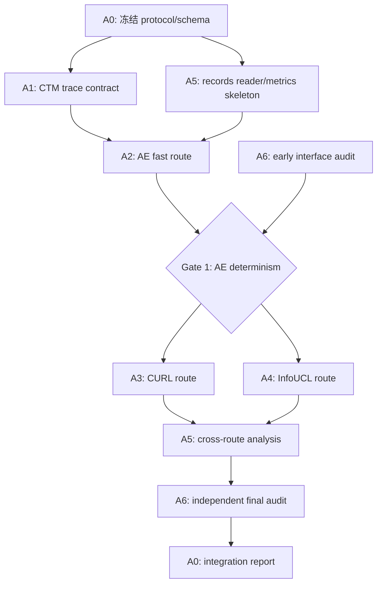

# UCL x CTM 多 Agent 实验执行与交接规范

## 1. 目的与当前阶段

本文件把 UCL x CTM 实验拆成可并行、可审查、可合并的 agent 任务，并规定所有工作如何通过 Markdown 和图片交接。当前阶段是实验实现准备阶段；任何 agent 在未通过对应验收门槛前，不得把结果写成“已经证明遗忘机制”或“CTM 改善了遗忘”。

核心研究问题见：

- `docs/UCL_CTM_Experiment_Design_CN.md`
- `docs/UCL_CTM_Experiment_Design_EN.md`
- `docs/UCL_CTM_Probe_Implementation_Plan.md`

第一阶段的统一判断是：原始 UCL 模型继续按自己的算法训练，CTM 作为冻结、只读的动态观测探针；先证明观测管线可靠，再分析 CTM 动态是否提供额外信息，最后才讨论干预或抗遗忘。

## 2. Agent 角色与信息边界

| Agent | 主要职责 | 必须阅读/核验的信息 | 主要交付物 | 文件所有权 |
| --- | --- | --- | --- | --- |
| A0 集成负责人 | 冻结协议、接口、目录、配置和验收；合并其他 agent | 本文件、三份 UCL x CTM 设计文档、所有 agent handoff | 总控 `STATUS.md`、版本锁定表、合并记录 | `configs/`、共享 schema、`STATUS.md` |
| A1 CTM 探针 | 核验 CTM forward、internal ticks、活动历史和同步表示；实现只读 trace wrapper | CTM 官方仓库：`models/ctm.py`、`models/modules.py`、图像分类 analysis；本地 `ctm-official/` | CTM trace 接口、张量 shape 说明、deterministic smoke test、探针报告 | `ucl_ctm_probe/probe/`、`reports/A1/` |
| A2 AE 路线 | 实现最小 FC AE、MNIST 流、固定旧样本和原生重构指标 | AE 参考仓库、中文实验方案第 3/5/7 节 | AE adapter、单 seed 结果、重构/latent/k-NN 记录和图 | `ucl_ctm_probe/adapters/ae/`、`reports/A2/` |
| A3 CURL 路线 | 原样复现 CURL；定位连续 latent、posterior、component expansion、replay 的事件 hook | CURL 官方目录和论文；先记录无法访问或版本不确定的地方 | CURL adapter、事件 schema、component identity 对齐说明和事件图 | `ucl_ctm_probe/adapters/curl/`、`reports/A3/` |
| A4 InfoUCL 路线 | 复现官方 baseline；确定 backbone/projection feature tap；做 InfoDrop off/on 配对实验 | InfoUCL 的 `train.py`、`test.py`、`models/`、`metrics/`、配置 | InfoUCL adapter、feature tap 决策、InfoDrop 配对 manifest 和图 | `ucl_ctm_probe/adapters/infoucl/`、`reports/A4/` |
| A5 分析与可视化 | 实现 drift、similarity structure、trajectory、synchronisation、dynamic separability 和统一作图 | record schema、实验方案第 6/8 节；不改模型训练逻辑 | 分析脚本、汇总表、checkpoint 面板图、分析报告 | `ucl_ctm_probe/evaluation/`、`reports/A5/` |
| A6 独立审查 | 审查数据/标签泄漏、检查点对齐、随机性、CURL 扩维误比较、CTM 变量混杂和过度解读 | 所有 handoff、manifest、代码 diff、图和原始表 | 审查报告、阻塞问题清单、通过/退回结论 | `reports/A6/` |

### 2.1 Agent 的共同禁区

- 不得把密码、token、私钥、SSH 命令中的认证信息写入仓库、配置、日志或 Markdown。
- 不得把原始 checkpoint、完整 CTM trace 或大规模结果提交到 Git。
- 不得同时修改共享 adapter protocol、record schema 和其他 agent 的目录。
- 不得更改原始 UCL loss、update rule 或官方评估协议，除非任务书明确批准为单因素消融。
- 不得只提交图而没有说明数据来源、脚本、参数、seed 和结论边界。

## 3. 依赖关系与启动顺序



推荐顺序：

1. A0 先发布 schema、manifest 字段、目录约束和固定实验配置。
2. A1、A5 可并行；A2 在接口草案稳定后开始。
3. AE 通过确定性和记录对齐验收后，A3 与 A4 才进入正式开发。
4. A6 在每个阶段结束时审查，不等到所有代码完成后才第一次检查。
5. A0 负责最终合并；A6 不负责修复自己发现的问题。

## 4. 强制交接格式

每个 agent 必须在 `reports/<agent-id>/` 生成一份 Markdown handoff。没有 handoff 的代码或实验结果视为未交付。

### 4.1 Handoff 模板

文件名：`reports/<agent-id>/handoff_<YYYYMMDD>_<short-name>.md`

```markdown
# Handoff: <agent-id> / <short-name>

## Status
- status: draft | ready-for-review | blocked | accepted
- branch:
- commit:
- owner:
- date:

## Question answered
<!-- 只写本 agent 负责的问题；不要扩张结论。 -->

## Source and version lock
- repository / local path:
- upstream commit or tag:
- files inspected:
- environment / command:

## Changes
- files added or modified:
- interface/schema changes:
- training-logic changes: none / explicitly listed

## Evidence
- command and exit status:
- raw table: `artifacts/.../*.csv` or `*.json`
- figure: `artifacts/.../figures/*.png` or `*.pdf`
- reproducibility seed(s):

## Findings
<!-- 观察到什么；每个结论说明证据位置。 -->

## Limitations and unresolved issues

## Next agent request
<!-- 明确下一位 agent 需要什么，不要只写“请继续”。 -->
```

### 4.2 图片与图表要求

- 有数值结果时，必须同时保存原始 CSV/JSON 和至少一张可读图；图片放在 `artifacts/<agent-id>/figures/`。
- 图名必须包含路线、seed、checkpoint 或事件范围，例如 `ae_seed01_checkpoint_panel.png`。
- 每张图必须在 handoff 中说明输入文件、脚本路径、关键参数和图中各轴含义。
- 只有接口/代码审查而没有数值结果时，至少提供一张流程图、模块图或 trace shape 图；若确实不适合画图，必须在 handoff 写明原因和替代证据。
- 最终汇报至少包含：实验流程图、三条路线的 checkpoint 对齐图、关键原始表格、失败/阴性结果说明。

## 5. 目录与文件交付约定

```text
CTM-EXP/
  docs/
    MULTI_AGENT_EXECUTION_PLAN.md
  configs/
  ucl_ctm_probe/
    adapters/ae/
    adapters/curl/
    adapters/infoucl/
    probe/
    evaluation/
    schemas/
    tests/
  reports/A0/ ... reports/A6/
  artifacts/<agent-id>/figures/
  artifacts/<agent-id>/tables/
  STATUS.md
```

`artifacts/` 中只提交压缩后的摘要表、精选图片和 manifest；原始 trace、模型 checkpoint、缓存、下载数据集和临时日志写入服务器结果目录，不进入 Git。

## 6. 分支、合并与 GitHub 管理

本次实验使用专用分支：`ctm-ucl-experiment-20261019`。现有 `ctm-ucl-probe-plan` 保留为设计基线，不重写历史。

- A0 从 `ctm-ucl-probe-plan` 创建并管理集成分支。
- 每个 agent 使用独立任务分支或 worktree；任务分支只修改自己的所有权目录。
- 合并前必须有 handoff、测试命令、原始表格和图，或适用的图形替代说明。
- 合并后保留 agent commit；必要时使用 merge commit 记录交接，避免 squash 掩盖实验来源。
- 每次合并在 `STATUS.md` 记录来源分支、commit、审查人、验收门槛和回滚点。

## 7. 本地—GitHub—服务器同步

```text
本地集成分支
  -> 本地测试与 handoff
  -> commit
  -> GitHub origin/ctm-ucl-experiment-20261019
  -> 服务器检出同名分支并运行
  -> 服务器只产生 ignored raw outputs
  -> 精简 manifest/summary/figures 回传
  -> commit/push 到同一分支
  -> 本地 fetch/review/merge
```

服务器同步由 A0 执行，或由单独授权的运维 agent 执行；模型 agent 不直接覆盖共享服务器目录。服务器端必须设置独立结果目录、环境记录和运行 manifest。服务器凭据使用外部 SSH key/agent 管理，不写入仓库。

每次同步前执行以下检查：

```bash
git status --short --branch
git diff --check
git diff --name-only --cached
rg -n -i 'password|passwd|private key|token|secret' .
```

若最后一条命令命中真实凭据，必须停止同步并清理工作区、索引和将要提交的历史；不要把凭据推送到 GitHub。用户已在对话中暴露服务器密码，首次连接前应轮换密码并改用专用 SSH key。

## 8. 阶段验收门槛

| Gate | 通过条件 | 负责人 |
| --- | --- | --- |
| G0 protocol | schema、固定旧样本规则、tick、checkpoint cadence 和 manifest 字段冻结 | A0 |
| G1 CTM trace | 相同固定输入重复运行，trace 在预设容差内一致；真实 sync shape 已记录 | A1 + A6 |
| G2 AE | `0/1/2 -> 3 -> 4` 可运行；样本 ID、checkpoint、native metrics、trace 对齐 | A2 + A5 + A6 |
| G3 CURL | 原始算法未被悄悄修改；component expansion 可追溯；posterior 扩维不被错误比较 | A3 + A6 |
| G4 InfoUCL | feature tap 有官方评估依据；InfoDrop off/on 只有一个预注册主要差异 | A4 + A6 |
| G5 analysis | 原始表格、图、脚本和 manifest 可重建；报告包含阴性结果和限制 | A5 + A6 |
| G6 integration | 代码、文档、图、摘要结果和同步记录齐全；无凭据或大文件泄露 | A0 |

## 9. 最终汇报包

最终汇报必须在 `reports/A0/final/` 包含：

1. `FINAL_REPORT_CN.md`：中文结论、路线状态、主要图表索引、限制和下一步。
2. `FINAL_REPORT_EN.md`：与中文版结论一致的英文版本。
3. `figures/00_pipeline_overview.png`：整体流程图。
4. `figures/<route>_checkpoint_panel.png`：AE、CURL、InfoUCL 各至少一张主面板；未完成路线用状态图并明确说明。
5. `tables/route_status.csv`：每条路线、seed、checkpoint、native metric 和 CTM metric 的摘要。
6. `manifests/`：源码 commit、配置、seed、数据流、probe hash 和运行环境。
7. `AUDIT_REPORT.md`：A6 的独立审查结论。

最终报告不得只展示最好的图；必须明确哪些结果是工程验证、哪些是关联证据、哪些仍是未验证假设。

## 10. 参考仓库

- CTM: https://github.com/SakanaAI/continuous-thought-machines
- CURL: https://github.com/google-deepmind/deepmind-research/tree/master/curl
- InfoUCL: https://github.com/learninginvision/InfoUCL
- AE: https://github.com/ashu-tagore/autoencoder-from-scratch
- 本实验 GitHub 仓库: https://github.com/zhonglina843-oss/CTM-EXP
